# Horizon Rendering Library


> **Version** `26.6` (API `0.8`) — A lightweight, explicit rendering abstraction layer.

HRL is a C/C++ rendering library designed to sit on top of multiple graphics backends (OpenGL, Vulkan, D3D11/12, Metal, and more) behind a unified, stable API. It is built around a simple principle: **nothing exists until you create it, and everything you create must be explicitly destroyed.**

---

## Showcase

A few screenshots showcasing HRL's rendering and debug capabilities:

|Debug shape|Density|Gizmo|
|-|-|-|
|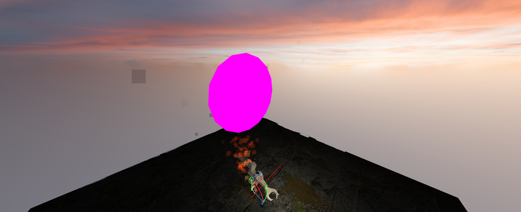|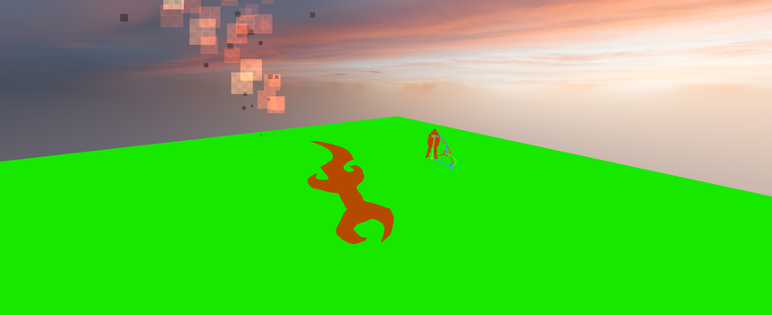|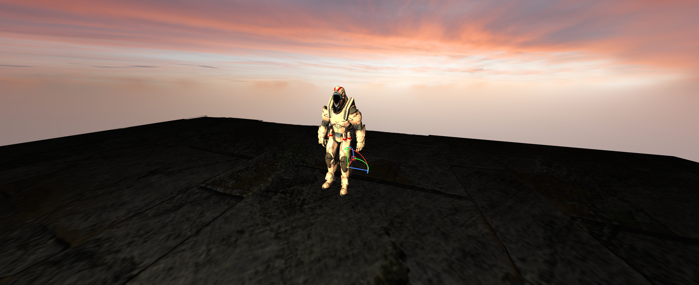|

|Lightning|Lit|Normal|
|-|-|-|
|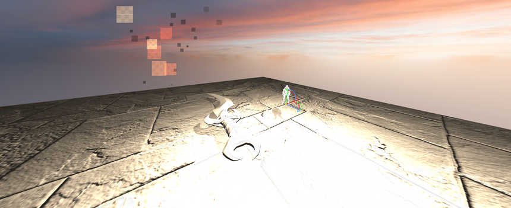|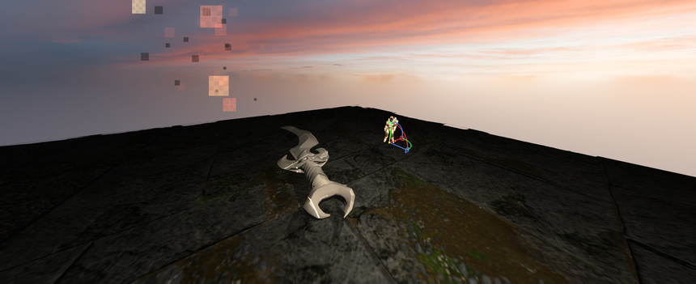|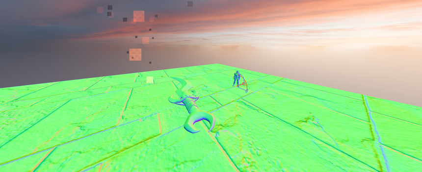|

|Wireframe|Unlit|VFX|
|-|-|-|
|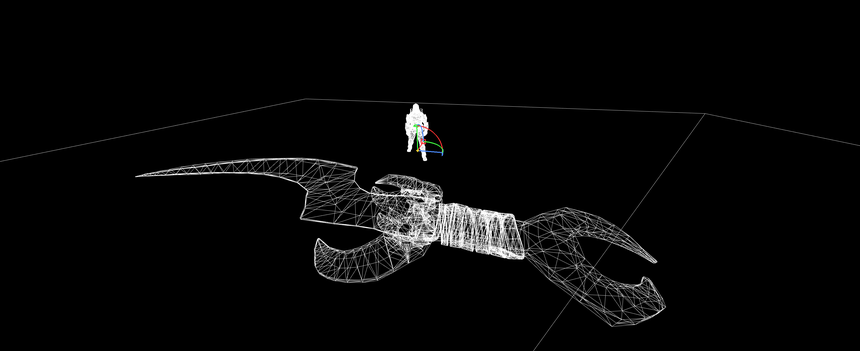|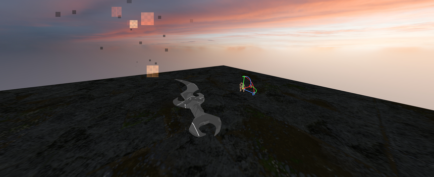|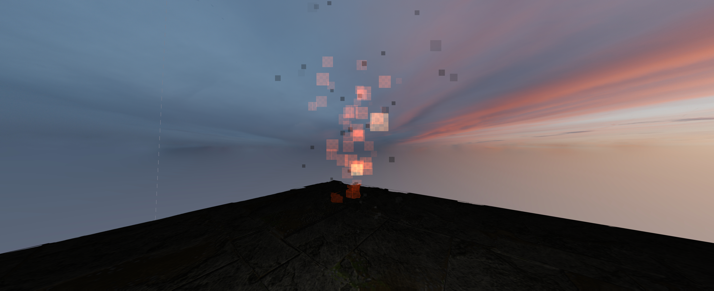|

|Debug Mesh Infos|UI|Landscape|
|-|-|-|
|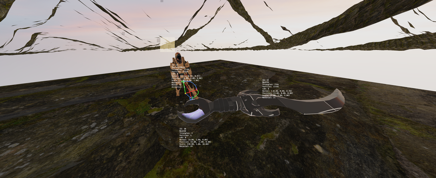|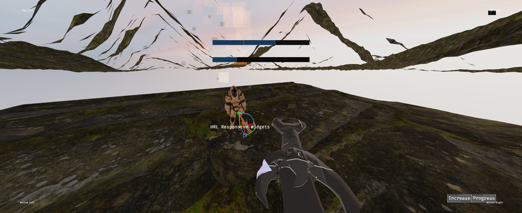|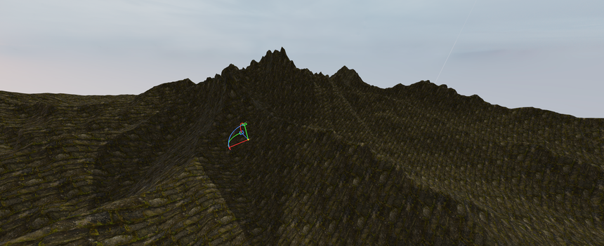|

# Full Documentation

[Official Site](https://oscar-soirey.github.io/Horizon-Rendering-Library)

---

# Credits

### Structure, OpenGL \& Vulkan backend

* Oscar Soirey
* contact : oscarsoirey.contact@gmail.com

### DirectX 11 backend

* [@CodeBYMehdi](https://github.com/CodeBYMehdi)
* contact : mehdibjjj@gmail.com

---

## Table of Contents

* [Supported Backends](#supported-backends)
* [Core Philosophy — Explicit Object Model](#core-philosophy--explicit-object-model)
* [Lifecycle](#lifecycle)
* [Object Overview](#object-overview)
* [Key Functions](#key-functions)

  * [Initialization](#initialization)
  * [Scenes](#scenes)
  * [Meshes \& Sprites](#meshes--sprites)
  * [Materials \& Shaders](#materials--shaders)
  * [Textures \& Fonts](#textures--fonts)
  * [Lights](#lights)
  * [Camera \& Viewports](#camera--viewports)
  * [Error Handling](#error-handling)
  * [Debug Utilities](#debug-utilities)
* [Minimal Example](#minimal-example)
* [Language Bindings](#language-bindings)

---

## Supported Backends

|Constant|Backend|Status|Platform|
|-|-|-|-|
|`HRL_VULKAN`|Vulkan 1.3 (native)|✅ **Primary backend.** Every new rendering feature is developed here|Windows, Linux|
|`HRL_OPENGL_33`|OpenGL 3.3|⚠️ **Deprecated.** Kept for existing projects, bug fixes only|Windows, Linux, macOS|
|`HRL_OPENGL_ES_30`|OpenGL ES 3.0|⚠️ Legacy mobile renderer (CMake `-DHRL_ENABLE_GLES3=ON`), no new feature|Android|
|`HRL_OPENGL_45`, `HRL_D3D11`, `HRL_D3D12`, `HRL_METAL`, `HRL_NVN`, `HRL_GNM`|—|Reserved|—|

"Reserved" constants are part of the API but have no backend in this repository: `HRL_Init` reports `HRL_INVALID_BACKEND_OPERATION` for them.

> **OpenGL deprecation.** The OpenGL 3.3 backend still builds and keeps its current behaviour, but it is frozen: no new feature, no feature parity with Vulkan, only fixes needed for stability or compilation. `HRL_Init(HRL_OPENGL_33)` reports a `HRL_SEVERITY_WEAK_WARNING` once. New projects should use `HRL_VULKAN`.

> **Vulkan backend rewrite (API 0.9).** Until 0.8 the Vulkan backend ran the OpenGL renderer through an OpenGL-on-Vulkan layer. It is now a native Vulkan 1.3 renderer, focused on 3D. The features it does not have yet are listed below; they report `HRL_INVALID_BACKEND_OPERATION` (warning, once) instead of rendering. See `docs/ARCHITECTURE.md` and `docs/ROADMAP.md`.

---

## Backend feature comparison

|Feature|Vulkan (native)|OpenGL 3.3 (deprecated)|
|-|:-:|:-:|
|Swapchain / presentation|✅ HRL presents in `HRL_EndFrame`|Application (`SwapBuffers`)|
|Off-screen rendering without a window|✅|❌|
|Static 3D meshes, LOD|✅ GPU driven: culling, LOD selection and two-phase occlusion culling in compute, draw-indirect-count|✅|
|Textures, filtering, mipmaps, anisotropy|✅ bindless|✅|
|PBR materials (albedo, normal, metallic / roughness, specular, AO, alpha test, emissive)|✅|✅ (no emissive)|
|Translucent materials (`HRL_MATERIAL_PARAM_TRANSLUCENT`), sorted back to front|✅|❌|
|Skeletal meshes|✅ skinned by a compute pass (not in the ray traced scene)|✅|
|Point / directional / spot / sky lights|✅ (no fixed light limit)|✅ (32 lights)|
|Directional shadows|✅ 4 stable cascades, PCF, alpha tested casters|✅ single map|
|Spot light shadows|✅ (4)|✅|
|Point light shadows|✅ with ray traced shadows only|✅ cube maps|
|Hardware ray traced shadows (`HRL_Vulkan_SetRayTracedShadows`)|✅ when the GPU supports it|❌|
|Image based lighting (prefiltered specular + irradiance + BRDF LUT)|✅|❌ (single reflection lookup)|
|Sky sphere (gradient or equirectangular texture)|✅|✅|
|HDR rendering, ACES tone mapping, exposure|✅|✅ (opt-in)|
|Bloom (post-process material, `bloomStrength`)|✅|✅|
|Fog (linear / exponential)|✅|✅|
|Color picking, screenshots, debug primitives, unlit / normal debug views|✅|✅|
|Custom shaders (`HRL_CreateShader`)|❌ planned as surface functions|✅ GLSL 3.30|
|Landscapes|✅ continuous LOD (CDLOD), float heights, edits, ray traced|✅ (8-bit heightmaps only)|
|Foliage: mesh instances (LOD, impostors, wind, interaction, scatter / paint / erase)|✅ GPU culled, millions of instances|❌|
|Procedural GPU grass|✅|❌|
|Custom post-process materials, MSAA|❌ planned (TAA instead of MSAA)|✅|
|SSAO, SSR, decals, volumetric fog, clouds, god rays|❌ planned|✅|
|Global illumination|❌ planned (hardware ray traced, with fallback)|✅ software BVH in shaders|
|Sprites, widgets, text, gizmos, VFX, 2D voxel worlds|❌ not started (3D first)|✅|
|FBX import, asynchronous loading (CPU side)|✅|✅|

### Global illumination (OpenGL 3.3 only)

```c
HRL_SetGlobalIlluminationMethod(scene, HRL_GI_DDGI);
HRL_SetGlobalIlluminationEnabled(scene, HRL_TRUE);
HRL_SetGlobalIlluminationIntensity(scene, 1.0f); // optional
```

|Method|What it does|Cost / quality|
|-|-|-|
|`HRL_GI_SSGI`|Screen space rays against the depth buffer|Cheapest, only what is on screen|
|`HRL_GI_VCT`|Voxel cone tracing (64³ voxel volume)|Medium, smooth, approximate|
|`HRL_GI_LPV`|Light propagation volume (32³, spherical harmonics)|Cheap once built, very soft and approximate|
|`HRL_GI_DDGI`|Probe grid updated by ray tracing, no leaks, multiple bounces|Recommended : close to the reference, stable|
|`HRL_GI_RAY_TRACING`|Ray traced bounces per pixel + temporal denoising|Accurate, a bit noisy when moving|
|`HRL_GI_PATH_TRACING`|Progressive path tracing (6 bounces)|Reference, converges while the camera is still|

Ray tracing is done in shaders on a BVH of the scene, so no ray tracing hardware is needed. These methods belong to the deprecated OpenGL 3.3 backend; the Vulkan backend will get its own hardware ray traced GI. The world space methods use the static 3D meshes and the landscapes, and update automatically when they or the lights change.

---

## Core Philosophy — Explicit Object Model

HRL does **not** manage object lifetimes on your behalf. Every object — scene, mesh, texture, shader, material, light, camera, viewport, font — must be explicitly created before use and explicitly destroyed when no longer needed.

**If you did not call the `HRL_Create*` function for an object, that object does not exist.** There are no implicit defaults loaded in the background, no hidden allocations, and no garbage collection. This design gives you full, deterministic control over GPU memory and render state.

The consequences of this model are straightforward:

* A mesh without a material assigned will not render correctly.
* A viewport without a camera assigned will not render.
* A material without a shader is invalid.
* A scene with no camera produces no output.

Every `HRL_Create*` function returns an `HRL_id`. Always check that the returned value is **not** `HRL_INVALID_ID` before using it.

---

## Lifecycle

A standard HRL application follows this structure:

```c
HRL_Init(backend)
HRL_InitContext(width, height, loader)
│
├── Create scenes, cameras, viewports
├── Create shaders, materials, textures
├── Create meshes and assign materials
├── Create lights
│
└── Main loop:
    ├── HRL_BeginFrame()
    ├── \\\[ update object transforms, uniforms, etc. ]
    ├── HRL_EndFrame()
    └── \\\[ swap buffers via your windowing layer (OpenGL only, Vulkan presents itself) ]

HRL_Shutdown() (clean every objects automatically)
```

---

## Object Overview

|Object|Created by|Depends on|
|-|-|-|
|Scene|`HRL_CreateScene`|—|
|Camera|`HRL_CreateCamera`|Scene|
|Viewport|`HRL_CreateViewport`|Scene, Camera|
|Shader|`HRL_CreateShader`|—|
|Material|`HRL_CreateMaterial`|Shader|
|Texture|`HRL_CreateTexture`|—|
|Font|`HRL_CreateFont`|—|
|Mesh|`HRL_CreateMesh`|Scene, Material|
|Sprite|`HRL_CreateMeshSprite`|Scene, Material|
|Light|`HRL_CreateLight`|Scene|
|Post Process|`HRL_CreatePostProcess`|Scene, Material|

---

## Key Functions

### Initialization

```c
HRL_Init(HRL_uint api);
```

Selects the graphics backend. Must be called first, before any other function.

```c
HRL_InitContext(HRL_uint width, HRL_uint height, void* loader);
```

Creates the rendering context. `loader` is your platform's function loader (e.g. `glfwGetProcAddress` for OpenGL). It is ignored by the Vulkan backend.

#### Vulkan

Vulkan is built by default (`-DHRL_ENABLE_VULKAN=ON`; the Vulkan SDK is needed to **build** HRL, not to run it: shaders are compiled to SPIR-V at build time and embedded). Requires a Vulkan 1.3 GPU driver. Before `HRL_InitContext`, give HRL the instance extensions required by your window system and a callback that creates the `VkSurfaceKHR` (see `hrl_vulkan.h` and `examples/vulkan_pbr`):

```c
HRL_Vulkan_SetInstanceExtensions(extensions, extension_count); // e.g. glfwGetRequiredInstanceExtensions
HRL_Vulkan_SetSurfaceCallback(CreateMySurface, my_window);
HRL_Init(HRL_VULKAN);
HRL_InitContext(width, height, NULL);

if (HRL_Vulkan_IsRayTracingSupported())
    HRL_Vulkan_SetRayTracedShadows(HRL_TRUE);   // optional
```

Without a surface callback the Vulkan backend renders off-screen (scenes, screenshots and picking still work). Environment variables: `HRL_VULKAN_VALIDATION=1` enables the Khronos validation layer (messages go to the HRL error callback), `HRL_VULKAN_NO_RAYTRACING=1` disables hardware ray tracing, `HRL_VULKAN_THREADS=n` sets the number of threads used to prepare a frame, `HRL_VULKAN_PIPELINE_CACHE=file` keeps compiled pipelines between runs (also `HRL_Vulkan_SetPipelineCachePath`). Diagnostics: `HRL_Vulkan_GetSceneStats`, `HRL_Vulkan_GetMemoryUsage`.

Build and run the example:

```
cmake -S . -B build -DCMAKE_BUILD_TYPE=Release -DHRL_BUILD_EXAMPLES=ON
cmake --build build --config Release -j
build/bin/hrl_vulkan_pbr        (build/bin/Release with Visual Studio; add --rt for ray traced shadows)
```

The examples are built by the main `CMakeLists.txt` and use the headers of `src/` directly; the HRL library and every executable are written to `build/bin`. See `examples/README.md`.

```c
HRL_Shutdown();
```

Releases all internal resources. Call before closing the window.

---

### Scenes

A **scene** is the top-level container for all renderable objects, lights, and cameras. You need at least one scene to render anything.

```c
HRL_id HRL_CreateScene(int renderOnScreen);
```

Pass `HRL_True` to render directly to the screen, or `HRL_False` to render into an off-screen texture (useful for render-to-texture, post-processing pipelines, etc.). Off-screen scenes default to 480×480; use `HRL_ResizeSceneTexture` to change this.

```c
void HRL_DeleteScene(HRL_id sceneid);
```

---

### Landscapes, foliage \& grass (Vulkan)

```c
// 1 x 1 km terrain from float heights (metres, any grid size)
HRL_id land = HRL_CreateLandscapeFromHeights(scene, heights, 1025, 1025);
HRL_SetLandscapeSize(land, 1000.0f, 1000.0f);
HRL_SetLandscapeMaterial(land, groundMaterial);

// a foliage kind: one or more parts (trunk, leaves...), each with a material
HRL_id tree = HRL_CreateFoliage(scene);
HRL_AddFoliageMesh(tree, trunk, trunkCount, trunkIdx, trunkIdxCount, bark);
HRL_AddFoliageMesh(tree, leaves, leafCount, leafIdx, leafIdxCount, leafMaterial); // alpha tested

HRL_FoliageScatter s = HRL_DefaultFoliageScatter();
s.density = 0.002f;                       // instances per square unit
HRL_ScatterFoliage(tree, land, &s);       // whole landscape (or a 3D mesh)
HRL_PaintFoliage(tree, land, x, z, 10.0f, &s); // brush
HRL_EraseFoliage(tree, x, z, 5.0f);

HRL_SetWind(scene, 1.0f, 0.3f, 0.6f, 0.5f);           // direction, strength, gusts
HRL_SetFoliageInteractor(scene, 0, px, py, pz, 1.0f); // the player bends plants

HRL_id grass = HRL_CreateGrass(land);     // procedural blades around the camera
HRL_SetGrassDensity(grass, 40.0f);
```

Instances are stored in 32 m cells on the GPU; culling (frustum + occlusion),
LOD selection with dithered cross-fades and the switch to octahedral impostors
(baked automatically) are done in compute shaders, so the CPU cost does not
depend on the instance count. With ray traced shadows, foliage closer than
the impostor distance (100 m at most) is part of the ray traced scene, leaves
alpha tested. Explicit placement: `HRL_AddFoliageInstances` (position, pitch / yaw / roll
in degrees, scale). See `examples/vulkan_nature`.

---

### Meshes \& Sprites

```c
HRL_id HRL_CreateMesh(HRL_id sceneid, HRL_uint type, float* vertices);
HRL_id HRL_CreateMeshFromFile(HRL_id sceneid, HRL_uint type, const char* data, size_t size);
HRL_id HRL_CreateMeshSprite(HRL_id sceneid);
```

`type` is one of `HRL_2D_Mesh`, `HRL_3D_Mesh`, or `HRL_3D_SkeletalMesh`. File loading supports `.fbx` and `.obj` formats.

Once created, a mesh must have a material assigned before it will render:

```c
void HRL_SetMeshMaterial(HRL_id meshid, HRL_id matid);
```

Transform functions:

```c
void HRL_SetMeshLocation(HRL_id meshid, float x, float y, float z);
void HRL_SetMeshRotation(HRL_id meshid, float pitch, float yaw, float roll);
void HRL_SetMeshScale(HRL_id meshid, float x, float y, float z);
```

---

### Materials \& Shaders

A **shader** is a compiled GPU program. A **material** is an instance of a shader with specific uniform values bound to it. The same shader can back many different materials.

```c
HRL_id HRL_CreateShader(const char* vertSrc, size_t vertSize, const char* fragSrc, size_t fragSize);
HRL_id HRL_CreateMaterial(HRL_id shaderid);
```

Setting uniforms on a material:

```c
void HRL_MaterialSetFloat(HRL_id matid, const char* name, float value);
void HRL_MaterialSetVec3(HRL_id matid, const char* name, float x, float y, float z);
void HRL_MaterialSetTexture(HRL_id matid, const char* name, HRL_id textureid);
// Also available: SetInt, SetBool, SetVec2, SetVec4
```

HRL provides built-in default shaders for common cases: `HRL_SpriteShader`, `HRL_Mesh2DShader`, `HRL_Mesh3DShader`, `HRL_DebugShader`.

---

### Textures \& Fonts

```c
HRL_id HRL_CreateTexture(const char* data, size_t size);
```

Accepted formats: `png`, `jpeg`, `bmp`, `tga`, `gif` (first frame), `hdr`, `psd` (partial). Data must be the raw file contents read in binary mode.

```c
HRL_id HRL_CreateTextureFromText(const char* text, HRL_id fontid,
    float fontSize, float wrapWidth,
    float r, float g, float b,
    float bg_r, float bg_g, float bg_b, float bg_a);
```

Rasterizes a UTF-8 string into a GPU texture. Pass `wrapWidth = 0` to disable line wrapping. Set `bg_a = 0` for a transparent background.

```c
HRL_id HRL_CreateFont(const char* data, size_t size);
```

Loads a TrueType font (`.ttf`) from a memory buffer. Required before calling `HRL_CreateTextureFromText`.

---

### Lights

```c
HRL_id HRL_CreateLight(HRL_id sceneid, HRL_uint type);
```

`type` is one of `HRL_PointLight`, `HRL_DirectionalLight`, or `HRL_SpotLight`.

```c
void HRL_SetLightColor(HRL_id lightid, float r, float g, float b);
void HRL_SetLightIntensity(HRL_id lightid, float intensity);
void HRL_SetLightAttenuation(HRL_id lightid, float attenuation);
void HRL_SetLightLocation(HRL_id lightid, float x, float y, float z);
void HRL_SetLightRotation(HRL_id lightid, float pitch, float yaw, float roll);
```

---

### Camera \& Viewports

A **camera** defines the point of view. A **viewport** maps a camera's output to a rectangular region of the screen. You need both to see anything rendered.

```c
HRL_id HRL_CreateCamera(HRL_id sceneid, HRL_uint type);  // HRL_Ortho or HRL_Perspective
void HRL_SetCameraPosition(HRL_id camid, float x, float y, float z);
void HRL_SetCameraRotation(HRL_id camid, float pitch, float yaw, float roll);
void HRL_SetCameraPerspectiveFov(HRL_id camid, float fov);    // degrees
void HRL_SetCameraOrthoVertical(HRL_id camid, float height);  // world units
```

```c
// Coordinates are normalized \\\[0..1]. (0,0) = top-left, (1,1) = bottom-right.
HRL_id HRL_CreateViewport(HRL_id sceneid, HRL_id cameraid, float x, float y, float w, float h);
```

Multiple viewports can be created for the same scene, enabling split-screen or picture-in-picture setups.

---

### Error Handling

HRL records the last error internally. Query it after any operation that returns an `HRL_id` or may fail:

```c
HRL_Error HRL_GetLastError(const char** detail, HRL_Severity* severity);
```

For continuous monitoring, register a callback that will be invoked every time an error occurs:

```c
void HRL_RegisterErrorCallback(HRL_ErrorCallback callback);
// Signature: void callback(HRL_Error code, HRL_Severity severity, const char* detail)
```

The convenience macro `HRL_CheckErrors()` prints any pending error to stdout, including the source file and line number. Suitable for debug builds.

Severity levels: `HRL_SEVERITY_WEAK_WARNING` · `HRL_SEVERITY_WARNING` · `HRL_SEVERITY_ERROR` · `HRL_SEVERITY_FATAL`

---

### Debug Utilities

**Debug views** override scene rendering with a diagnostic mode:

```c
void HRL_DrawSceneAsDebugMode(HRL_id sceneid, HRL_uint mode);
// mode: HRL_DebugViewNone | HRL_DebugViewNormal | HRL_DebugViewLights
```

**Immediate-mode debug geometry** (must be called every frame to persist):

```c
void HRL_DrawDebugSegment(...);   // Line segment
void HRL_DrawDebugCircle(...);    // Circle (hollow or solid)
void HRL_DrawDebugCapsule(...);   // Capsule (hollow or solid)
void HRL_DrawDebugPolygon(...);   // Arbitrary polygon
void HRL_DrawDebugPoint(...);     // Screen-space point
```

**Screenshot:**

```c
void HRL_TakeScreenshot(HRL_id sceneid, const char* path); // Saves as PNG
```

---

## Minimal Example

```c
// 1. Initialize
HRL_Init(HRL_OPENGL_33);
HRL_InitContext(1280, 720, glfwGetProcAddress);

// 2. Scene, camera, viewport
HRL_id scene    = HRL_CreateScene(HRL_True);
HRL_id camera   = HRL_CreateCamera(scene, HRL_Perspective);
HRL_id viewport = HRL_CreateViewport(scene, camera, 0.f, 0.f, 1.f, 1.f);
HRL_SetCameraPerspectiveFov(camera, 60.f);
HRL_SetCameraPosition(camera, 0.f, 0.f, -5.f);

// 3. Shader, material, texture
HRL_id shader   = HRL_CreateShader(vert_src, vert_len, frag_src, frag_len);
HRL_id material = HRL_CreateMaterial(shader);
HRL_id texture  = HRL_CreateTexture(png_data, png_size);
HRL_MaterialSetTexture(material, HRL_T_ALBEDO, texture);

// 4. Mesh
HRL_id mesh = HRL_CreateMeshFromFile(scene, HRL_3D_Mesh, obj_data, obj_size);
HRL_SetMeshMaterial(mesh, material);

// 5. Render loop
while (!glfwWindowShouldClose(window)) {
    HRL_BeginFrame();
    HRL_EndFrame();
    glfwSwapBuffers(window);
    glfwPollEvents();
}

// 6. Cleanup
HRL_Shutdown();
```

---

*HRL is licensed under the Apache License 2.0. See* [*LICENSE*](http://www.apache.org/licenses/LICENSE-2.0) *for details.
Contact: oscarsoirey.contact@gmail.com*

---

## Language Bindings

Bindings for **Python** (ctypes), **C#** (P/Invoke), **Rust**, **Go** (cgo) and **LuaJIT** (FFI) are generated from the C headers by `bindings/generate.py` (Python 3.8+ only, no SWIG). Run `generate-bindings.bat` (or `python bindings/generate.py`) after changing the API. See [bindings/README.md](bindings/README.md).

```python
import hrl
hrl.HRL_Init(hrl.HRL_VULKAN)
hrl.HRL_InitContext(1280, 720, None)
scene = hrl.HRL_CreateScene(0)
```
